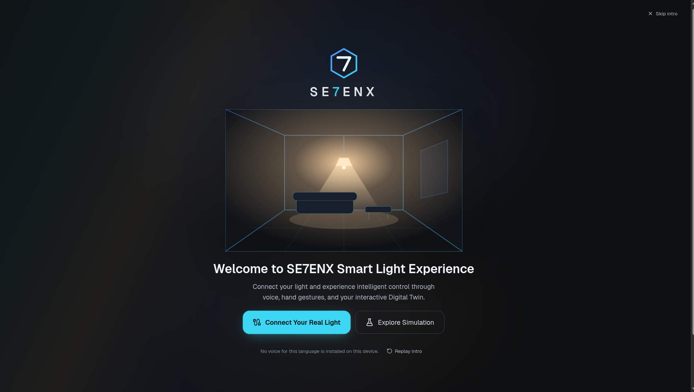
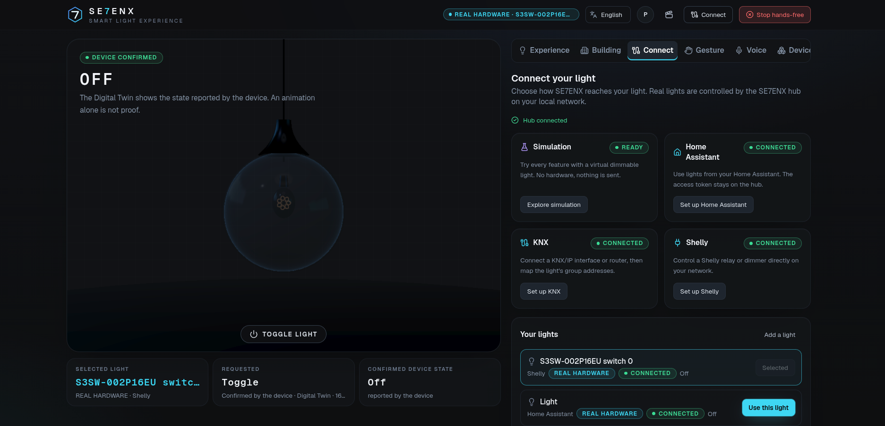
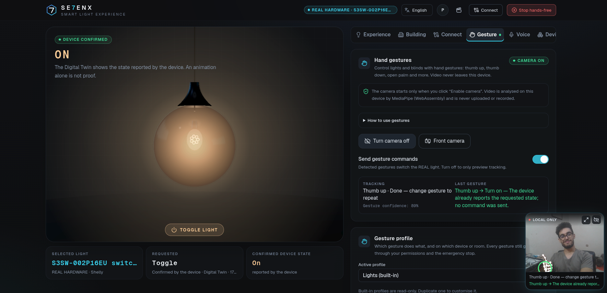
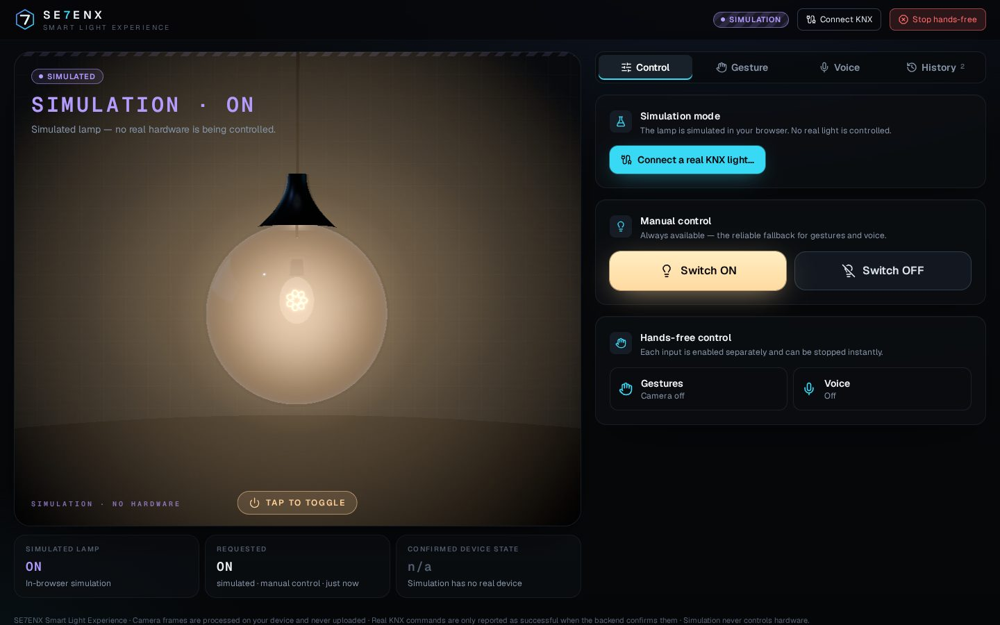

# NEXORA — Local-First Smart Building Platform

<p align="center">
  
</p>

<p align="center">
  <strong>One interface. Multiple ways to interact with your building.</strong>
  <br>
  Control and explore smart-building experiences through a modern interface designed around connected devices, 3D visualization, voice interaction, and hand gestures.
</p>

<p align="center">
  <a href="https://ko-fi.com/se7enx">
    
  </a>
  <a href="https://github.com/Ab40D/NEXORA/issues">
    
  </a>
  
</p>

**NEXORA is an experimental, local-first smart-building platform developed by Abdelkhalek Mammeri.** Its goal is to make building automation easier to interact with by bringing device control, visual feedback, and different interaction methods into one place.

The project is evolving from a smart-light experience toward a broader platform for homes and professional buildings. It is actively under development, and the availability and verification level of individual integrations depend on the current implementation.

## Table of contents

- [Overview](#overview)
- [Screenshots](#screenshots)
- [Features](#features)
- [Architecture](#architecture)
- [Installation](#installation)
- [Local development](#local-development)
- [Device integrations](#device-integrations)
- [Privacy and security](#privacy-and-security)
- [Known limitations](#known-limitations)
- [Documentation](#documentation)
- [Contributing](#contributing)
- [Support the project](#support-the-project)
- [About the developer](#about-the-developer)
- [License](#license)

## Overview

Traditional building automation systems often separate device control, automation logic, and user interfaces across different applications. NEXORA explores a more unified approach.

The platform is being developed around four ideas:

- **One interface:** a central place to interact with connected building devices.
- **Multiple interaction methods:** manual controls, voice commands, and camera-based hand gestures.
- **Visual feedback:** a 3D interface that helps users understand the current lighting experience.
- **Local-first operation:** support for running the platform on a local machine or home server, with the aim of reducing dependence on external services.

The long-term direction is to support different devices and protocols through a unified interaction layer, rather than requiring users to operate a separate interface for every system.

## Screenshots

### Current interface

<p align="center">
  
</p>

The main interface introduces the visual experience and provides a starting point for interacting with the platform.

### Inside the platform

<p align="center">
  
</p>

An additional view of the platform and its interface.

### Camera and hand gestures

<p align="center">
  
</p>

The gesture experience explores hands-free interaction through camera-based hand tracking.

### Previous SE7ENX interface

<p align="center">
  
</p>

The earlier SE7ENX Smart Light Experience introduced the interactive 3D lighting concept that helped shape the direction of NEXORA.

## Features

### Interactive 3D lighting

- A 3D lamp interface built with React Three Fiber and Three.js.
- Visual feedback that reflects the state represented by the application.
- Simulation mode for exploring the interface without connecting physical hardware.
- Responsive layout for desktop and mobile screens.
- A fallback interface for environments without WebGL support.

**Important:** a visual state is not automatically proof that a physical device changed state. The application must distinguish simulation, requested commands, and confirmed device feedback.

### Lighting control and brightness

NEXORA's direction includes both switching and more detailed lighting control.

Depending on the connected integration and device capabilities, this can include:

- Switching compatible lights ON and OFF.
- Representing device state in the interface.
- Brightness control for supported dimmable devices.
- Mapping supported device commands to the appropriate protocol or integration.

Brightness control requires a compatible device and a supported command mapping. KNX datapoint types and device capabilities differ, so not every actuator supports the same functions. Check the current implementation and device configuration before relying on brightness control in a real installation.

### Hand gestures

NEXORA explores camera-based interaction using MediaPipe hand tracking.

The intended interaction flow includes:

1. Enable the camera and grant browser permission.
2. Position your hand inside the camera frame.
3. Use the configured gesture zones to trigger supported actions.
4. Adjust gesture settings where available.

Lighting conditions, camera quality, tracking confidence, and device performance can affect recognition. Gesture control is an alternative input method, not a safety mechanism.

### Voice interaction

The platform also explores voice commands through the browser's speech-recognition capabilities.

The available languages, supported phrases, and recognition behaviour depend on the current implementation and browser. Speech recognition may rely on an external browser-vendor service rather than running entirely on the local device.

### Login and interface access

The interface may include an access or login screen as part of the evolving platform experience. Authentication must be distinguished from actual authorization: a login screen alone does not establish secure user management, device permissions, or multi-user isolation.

Before using NEXORA in a shared or production environment, verify that the current build implements the required authentication, session handling, access controls, and secure storage. Do not expose credentials, access tokens, or device secrets in a public repository.

### Smart-building integrations

The project's integration direction includes:

- **KNX:** building automation through a local bridge or a supported Home Assistant setup.
- **Home Assistant:** access to compatible entities and integrations.
- **Shelly:** local control of supported devices, depending on model and integration support.
- **MQTT and automation workflows:** potential connections to local automation systems as development progresses.

Integration availability and verification status can differ between versions. Consult the relevant documentation before connecting physical equipment.

## Architecture

NEXORA is built around a web interface and a local integration layer.

```text
                   NEXORA interface
                          |
            +-------------+-------------+
            |             |             |
         Manual         Voice         Gestures
            |             |             |
            +-------------+-------------+
                          |
                 Device interaction layer
                          |
          +---------------+----------------+
          |               |                |
       Home Assistant    Shelly            KNX
          |               |                |
          +---------------+----------------+
                          |
                 Connected devices
```

This diagram describes the platform's intended integration model, not a guarantee that every path is implemented or verified in every release.

The current codebase uses technologies including:

- **Next.js, React and TypeScript** for the web application.
- **React Three Fiber and Three.js** for 3D visualization.
- **Zustand** for client-side state management.
- **MediaPipe** for hand tracking.
- **Web Speech API** for browser-based voice interaction.
- **Python, FastAPI and xknx** for the SE7ENX KNX bridge.
- **Docker Compose** for the local appliance deployment.

## Installation

### Option 1 — Run the local appliance

The local appliance is intended to package the web interface and local hub into a deployment that can run on a computer or home server.

**Requirements**

- Docker Engine
- Docker Compose plugin
- A computer on the same network as the devices you intend to connect
- The repository's deployment files and configuration

Clone the repository:

```bash
git clone https://github.com/Ab40D/NEXORA.git
cd NEXORA
```

Prepare the appliance configuration:

```bash
cd deploy/appliance
cp .env.example .env
```

Review `.env` and configure the options required for your installation. Do not commit real credentials, private keys, or access tokens.

Build and start the appliance:

```bash
docker compose up -d --build
```

Check the running services and logs:

```bash
docker compose ps
docker compose logs -f
```

If the current appliance configuration exposes the web interface on port `8787`, open the following address from a browser on your network:

```text
http://<host-machine-ip>:8787
```

Replace `<host-machine-ip>` with the address of the machine running the appliance. Confirm the actual port and service names in the Compose configuration if they differ in your checkout.

To stop the appliance:

```bash
docker compose down
```

For network setup, configuration options, troubleshooting, and upgrade guidance, consult [`docs/LOCAL_DEPLOYMENT.md`](docs/LOCAL_DEPLOYMENT.md).

### Option 2 — Run the web application locally

**Requirements**

- Node.js 20.9 or newer
- npm
- Python 3.11 or newer if you also intend to run the bridge
- Git

Install the dependencies from the repository root:

```bash
npm install
```

Start the development server:

```bash
npm run dev
```

Open:

```text
http://localhost:3000
```

Simulation mode is the appropriate starting point when you want to explore the interface without connecting hardware.

### Run the KNX bridge for development

If you want to work on the Python bridge, create a virtual environment:

```bash
cd bridge
python3 -m venv .venv
source .venv/bin/activate
pip install -e ".[dev]"
```

Follow [`bridge/README.md`](bridge/README.md) for bridge configuration and startup instructions.

For safe initial development, use the documented test setup and simulated KNX interface. Do not point experimental commands at a live building installation until the configuration and safety controls have been reviewed.

## Device integrations

### KNX

The SE7ENX bridge uses Python and xknx to communicate with compatible KNX IP interfaces and routers.

Depending on the configuration, this can involve:

- A KNX group address for the target function.
- An appropriate datapoint type (DPT).
- An optional status or feedback address.
- A configured KNX gateway and permitted group addresses.

For switching, DPT 1.001 is commonly used. DPT 5.001 is commonly used for percentage values. Actual support depends on the device objects, bridge implementation, and configured mappings.

A positive command acknowledgement and a confirmed physical device state are not the same thing. Where available, use actuator feedback or a read response to confirm the reported state.

**Hardware verification:** the earlier SE7ENX audit reported that the KNX path had been tested against a protocol-level fake interface, not verified end-to-end on real KNX hardware. Review the latest hardware test matrix before using it in a real installation.

### Home Assistant

Home Assistant can provide access to compatible devices through its own integrations.

The connection method, required permissions, network reachability, and supported entities depend on the current application version. Use a dedicated, least-privileged account where possible, and review token storage and revocation behaviour before connecting a real installation.

The earlier SE7ENX audit reported testing the Home Assistant path against a mock server rather than a real Home Assistant installation.

### Shelly

The project's local-first direction includes local-IP control for supported Shelly devices. Compatibility depends on the model, firmware, connection method, and implementation available in the version you are running.

Use the local integration instructions supplied with the current release, and avoid exposing device interfaces directly to the public internet.

## Privacy and security

NEXORA is being developed with local-first operation in mind. However, local deployment does not automatically mean every feature is fully offline.

### Camera and hand tracking

- Camera access should only begin after the user explicitly enables it and grants permission.
- Review the current implementation to confirm how frames and landmarks are processed.
- In the earlier SE7ENX implementation, the hand-tracking library sent usage telemetry to Google's service. The audit reported that this telemetry did not contain camera images, hand landmarks, or audio.

Do not assume that telemetry behaviour remains unchanged across dependency versions; check the current network behaviour and privacy documentation.

### Microphone and voice recognition

Browser speech recognition may send audio to the browser vendor's speech service. Whether recognition runs on-device depends on browser support, language availability, and settings.

### Credentials and network access

- Never publish `.env` files containing real secrets.
- Do not expose a KNX bridge, Home Assistant instance, or Shelly device directly to the public internet without a reviewed security design.
- Keep allowed origins and device permissions as restrictive as possible.
- Use HTTPS where required, particularly for remote browser access and sensitive authentication flows.
- Review session storage, token lifetime, revocation, and user permissions before using a shared installation.

For detailed findings and known issues, consult [`SECURITY_AUDIT.md`](SECURITY_AUDIT.md), [`docs/SECURITY.md`](docs/SECURITY.md), and [`DEPLOYMENT_CHECKLIST.md`](DEPLOYMENT_CHECKLIST.md).

## Known limitations

NEXORA is under active development. Depending on the version, known limitations may include:

- Some integration paths have not yet been verified against physical devices.
- Device capabilities vary by protocol, model, and configuration.
- Voice recognition depends on browser support and may use external services.
- Gesture recognition is affected by lighting, camera quality, and performance.
- A displayed state must not be treated as confirmed hardware feedback unless the integration provides that confirmation.
- Authentication and access-control features require independent verification before multi-user or production use.

**Do not use an experimental build as the sole control interface for safety-critical equipment.** Keep appropriate manual controls and established building protections in place.

## Documentation

The repository includes supporting material for users, installers, and contributors. Check which documents are present in your current checkout.

| Document | Purpose |
|---|---|
| [`docs/LOCAL_DEPLOYMENT.md`](docs/LOCAL_DEPLOYMENT.md) | Local appliance installation and configuration |
| [`docs/HARDWARE_TEST_MATRIX.md`](docs/HARDWARE_TEST_MATRIX.md) | Hardware test status and verification evidence |
| [`docs/LOCAL_FIRST_PLAN.md`](docs/LOCAL_FIRST_PLAN.md) | Local-first design direction |
| [`docs/ARCHITECTURE.md`](docs/ARCHITECTURE.md) | System architecture and command flow |
| [`docs/API.md`](docs/API.md) | Bridge API contract |
| [`docs/SECURITY.md`](docs/SECURITY.md) | Security model and guidance |
| [`bridge/README.md`](bridge/README.md) | KNX bridge setup and operation |
| [`USER_GUIDE.md`](USER_GUIDE.md) | User instructions |
| [`TECHNICAL_SPECIFICATION.md`](TECHNICAL_SPECIFICATION.md) | Technical requirements and compatibility |
| [`SECURITY_AUDIT.md`](SECURITY_AUDIT.md) | Audit findings and readiness assessment |
| [`DEPLOYMENT_CHECKLIST.md`](DEPLOYMENT_CHECKLIST.md) | Deployment validation checklist |
| [`CHANGELOG.md`](CHANGELOG.md) | Project changes |

## Contributing

NEXORA is an evolving project, and contributions are welcome.

You do not need to be an expert in every part of building automation to contribute. Useful contributions include:

- Fixing bugs and improving reliability.
- Improving the interface, accessibility, and mobile experience.
- Developing integrations and device adapters.
- Improving KNX, MQTT, Home Assistant, and local-network workflows.
- Testing on different operating systems and hardware.
- Improving documentation, translations, and installation instructions.
- Reviewing security, privacy, and error handling.
- Proposing ideas that make building automation more accessible and easier to maintain.

### How to contribute

1. Open an [issue](https://github.com/Ab40D/NEXORA/issues) to report a bug or discuss a substantial change.
2. Fork the repository.
3. Create a branch for your work.
4. Make and test your changes.
5. Open a pull request describing what changed and how it was tested.

Please do not include real credentials, private keys, personal access tokens, or sensitive building-network details in issues, screenshots, logs, or pull requests.

## Support the project

If you find NEXORA useful or want to support its continued development, you can contribute through Ko-fi.

<p align="center">
  <a href="https://ko-fi.com/se7enx">
    
  </a>
</p>

Support helps make more time available for development, testing, documentation, and future integrations. Contributions are optional; feedback, testing, and code contributions are also valuable.

## About the developer

**Abdelkhalek Mammeri** — electronics and building-automation enthusiast working on the intersection of smart buildings, IoT, local-first software, and human-computer interaction.

- **Website:** [se7en-bay.vercel.app](https://se7en-bay.vercel.app/)
- **GitHub:** [@Ab40D](https://github.com/Ab40D)
- **LinkedIn:** [Abdelkhalek Mammeri](https://www.linkedin.com/in/abdelkhalekmammeri/)
- **YouTube demo:** [Watch the project video]([https://www.youtube.com/watch?v=lMxjzDLOLpM](https://www.youtube.com/watch?v=jmIqzMuaxs8))
- **Ko-fi:** [ko-fi.com/se7enx](https://ko-fi.com/se7enx)

## License

Check the repository's `LICENSE` file for the applicable license and terms. Third-party libraries and assets remain subject to their respective licenses.
