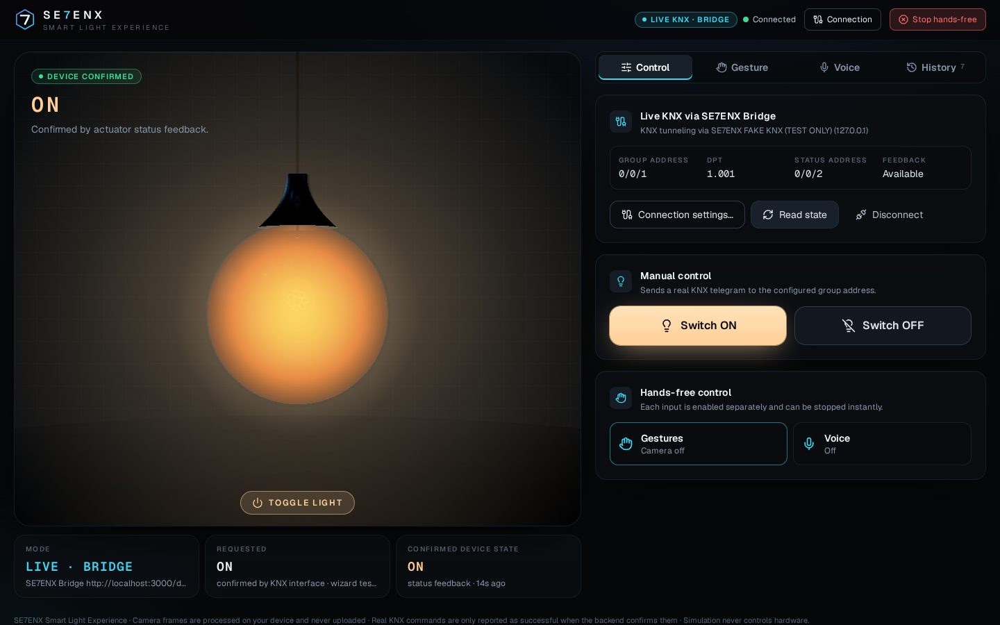
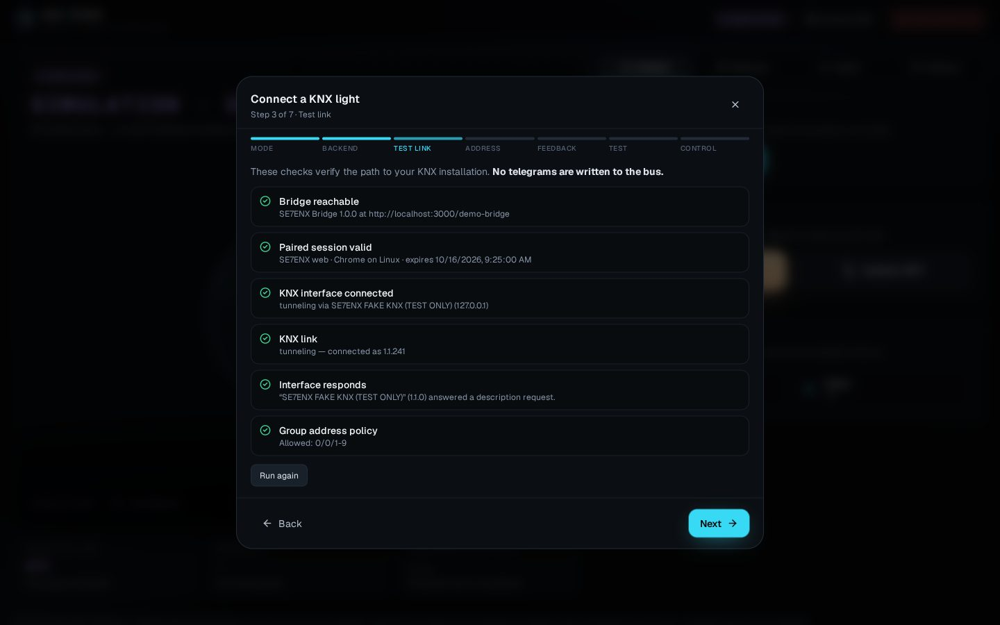
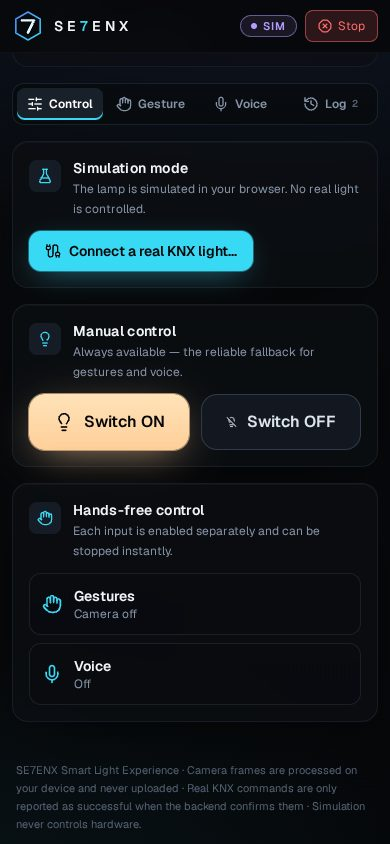

# SE7ENX Smart Light Experience

Control a real **KNX** light with **hand gestures**, **voice** and **manual controls** —
or try everything instantly in a clearly labelled **simulation**. A premium 3D lamp
reflects the state your installation actually reports.


| Live KNX — state confirmed by actuator feedback | Wizard — connectivity test | Mobile |
| --- | --- | --- |
|  |  |  |

## Highlights

* **Instant simulation** — opens with an interactive 3D lamp; nothing to install. Simulation is labelled everywhere and never touches hardware.
* **Real KNX** via the **SE7ENX Bridge** (Python + xknx, runs on your LAN) or via your existing **Home Assistant** KNX integration.
* **Honest state** — *simulated*, *requested* and *confirmed* state are kept separate. A command is "confirmed" only when the KNX interface returned a positive `L_Data.con`; the lamp shows the device as ON/OFF only when the actuator's **status address** (or a read response) says so — otherwise it says `UNVERIFIED`.
* **Gestures** (MediaPipe, 100 % on-device): raise an open hand above the ON line → ON, lower it below the OFF line → OFF; smoothing, dwell, cooldown, re-arm, confidence gating, calibration.
* **Voice** (Web Speech API): strict allowlist — “Light on”, “Turn the light off”, *« Allume la lumière »*, *« Ferme la lumière »*, «شغّل الضوء», «طفّي الضو» …
* **Safety** — visible emergency stop (header button or `Esc`), no automatic switching after connecting, explicit acknowledgement before the first test telegram, default-deny group-address policy on the bridge.
* **Responsive & accessible** — phone/tablet/desktop, keyboard operable, visible focus, screen-reader announcements, reduced motion, 2D fallback without WebGL.

## How it works

```
Browser (Vercel-hosted UI) ──fetch/SSE──► SE7ENX Bridge (your LAN) ──KNXnet/IP──► KNX IP interface/router ──► bus ──► actuator ──► light
            └──────────────WebSocket (HA OAuth)──────► Home Assistant ──KNX integration──┘
```

Vercel serves **only the UI** and `GET /api/health`. Serverless functions cannot reach
your private LAN, send KNXnet/IP UDP or hold a tunnel, and the browser cannot speak
raw UDP — so real KNX traffic always goes **browser → bridge (or HA) → KNX**.
Details: [docs/ARCHITECTURE.md](docs/ARCHITECTURE.md) · API contract: [docs/API.md](docs/API.md) ·
Security: [docs/SECURITY.md](docs/SECURITY.md).

## Quick start (local development)

Requirements: Node.js ≥ 20.9 (npm), for the bridge Python ≥ 3.11.

```bash
npm install          # also copies the MediaPipe WASM runtime into public/mediapipe
npm run dev          # http://localhost:3000 — simulation works immediately
```

Try a full real-KNX flow **without hardware** (real bridge + xknx talking to a fake
KNXnet/IP interface that identifies itself as `SE7ENX FAKE KNX (TEST ONLY)`):

```bash
cd bridge && python3 -m venv .venv && . .venv/bin/activate && pip install -e ".[dev]"
python tools/dev_stack.py --port 8787 --pairing-code DEMO-2026
# In the app: Connect KNX → Local KNX Bridge → http://127.0.0.1:8787 → code DEMO-2026
# Group address 0/0/1, status address 0/0/2
```

## Connect a real KNX light

### Option A — SE7ENX Bridge (recommended for KNX IP interfaces/routers)

1. Install the bridge on a computer/Raspberry Pi in the **same network** as your KNX IP
   interface — see [bridge/README.md](bridge/README.md) (venv, Docker or systemd).
2. Configure it (`bridge/.env.example`): your interface (`SE7ENX_KNX_GATEWAY_IP`),
   the light's addresses (`SE7ENX_ALLOWED_GROUP_ADDRESSES=0/0/1,0/0/2`) and your web
   app origin (`SE7ENX_ALLOWED_ORIGINS=https://your-app.vercel.app`).
3. Start it and note the **pairing code** in its log.
4. In the app: **Connect KNX → Local KNX Bridge**, enter the bridge URL, pair, run the
   connectivity test (no telegrams are written), enter the light's **group address**
   (+ DPT) and **status address**, read the current state, then — after the safety
   acknowledgement — send a test ON/OFF. Finally enable gestures and/or voice.

### Option B — Home Assistant

Requirements: Home Assistant with the **KNX integration** configured, reachable over
**HTTPS** from your device (e.g. Nabu Casa remote UI or your own domain). No HA
configuration changes are needed: HA's OAuth token endpoint accepts cross-origin
requests and the WebSocket API is not subject to CORS.

**Connect KNX → Home Assistant**, enter the HA URL and **Sign in with Home Assistant**.
You log in on your own HA login page; SE7ENX never sees your password and never asks
for a long-lived token. The short-lived session lives only in that browser tab and is
revoked on Disconnect. Capabilities:

| HA account | Commands | Bus confirmation | Device state |
| --- | --- | --- | --- |
| Administrator | `knx.send` | outgoing `knx_event` observed | live `knx_event` + `knx.read` responses |
| Regular user | `knx.send` | not available (reported as *accepted*) | `knx.read` with response (recent HA versions) |

## Deploy the web app to Vercel

1. Push this repository to GitHub/GitLab and **import it in Vercel** (framework
   preset *Next.js*; build command `npm run build`, install `npm install` — defaults).
2. **No environment variables are required** and none may contain secrets. Optional:
   `NEXT_PUBLIC_DEFAULT_BRIDGE_URL` (pre-filled bridge URL), `SE7ENX_FRAME_ANCESTORS`
   (allow embedding; default `'none'`), `NEXT_PUBLIC_HAND_MODEL_URL`, `NEXT_PUBLIC_MEDIAPIPE_WASM_BASE`.
   Variables read in `next.config.ts` are applied **at build time** — redeploy after changes.
3. The build copies the MediaPipe WASM runtime into `public/mediapipe` and verifies the
   SHA-256 of the self-hosted hand model (`public/models/hand_landmarker.task`).
4. `.vercelignore` keeps `bridge/` out of the deployment.
5. Add the deployment URL (e.g. `https://se7enx.vercel.app`) to the bridge's
   `SE7ENX_ALLOWED_ORIGINS`.
6. Check `https://<your-app>/api/health` → `{"ok":true,…,"knx":{"handledHere":false}}`.

### Reaching a LAN bridge from the HTTPS deployment

| Setup | Works in |
| --- | --- |
| `http://127.0.0.1:8787` (bridge on the same computer) | Chrome, Edge, Firefox — not Safari |
| `https://bridge.<tailnet>.ts.net` via **Tailscale Serve** | All browsers, phones included (recommended) |
| `https://<LAN-IP>:8787` with a trusted certificate (mkcert) | All browsers that trust the certificate |
| `http://<LAN-IP>:8787` | Chrome/Edge 142+ after allowing **Local network access**; blocked in Safari/Firefox |

The app detects these cases, warns in the wizard, and annotates requests with
`targetAddressSpace` where Chrome needs it. Full options: [bridge/README.md](bridge/README.md#reaching-the-bridge-from-the-web-app).

## Supported hardware

* **Gateways**: any KNXnet/IP **tunnelling interface** (UDP tunnelling v1, TCP tunnelling v2,
  KNX Secure tunnelling) or **KNX IP router** (routing, secure routing) supported by xknx 4.x.
  The interface needs a free tunnel slot. KNX Secure keys stay on the bridge.
* **Actuators**: switch actuator channels with a **DPT 1.001** switching object (ON/OFF), or
  dimming actuators via a **DPT 5.001** brightness object (ON sends the configured level).
  A **status/feedback object** on its own group address is strongly recommended — without it
  the real device state cannot be confirmed.
* Physical KNX hardware was **not available** while building this release; the KNX path was
  verified end to end against a protocol-level fake KNXnet/IP interface (see the
  [implementation report](IMPLEMENTATION_REPORT.md)).

## Gestures

1. **Gesture** tab → **Enable camera** (the browser asks for permission; video stays on your device).
2. Raise an **open hand** above the cyan line and hold ~0.5 s → ON. Lower it below the amber
   line and hold → OFF. After a trigger, move the hand out of the zone to re-arm.
3. **Calibrate** adapts the lines to your position (hold low, then high). Tune hold time,
   cooldown and thresholds; switch *Send gesture commands* off to only preview tracking.
4. Good light and the hand fully in frame help; with low tracking confidence nothing is inferred.

## Voice

1. **Voice** tab → **Enable voice commands** (asks for the microphone once, records nothing).
2. Press **Listen** and say a command, or start a **60 s hands-free** session.
3. Languages: English, French, Arabic (Algerian Darija and MSA). Only allowlisted phrases
   work; negations (“don't turn the light on”) and anything else are ignored.

Browser support varies: Chrome and Safari provide speech recognition (usually through
Google's/Apple's online service — the UI says so); Firefox does not enable it by default;
Chrome 139+ can recognize on-device after a language-pack download (opt-in switch).
Manual control always works.

## Testing

```bash
npm run lint           # ESLint (Next.js core-web-vitals + TypeScript + React Compiler rules)
npm run typecheck      # tsc --noEmit
npm test               # Vitest: unit + integration (mock bridge, mock HA WebSocket, contract vs real bridge)
npm run build          # production build
npx playwright install chromium && npm run test:e2e   # browser tests (starts next + the bridge dev stack)
cd bridge && python -m pytest && ruff check .          # bridge tests incl. real xknx ↔ fake KNXnet/IP interface
```

## Troubleshooting

| Problem | What to check |
| --- | --- |
| Lamp shows `SIMULATION` | You are in simulation — use **Connect KNX**. Simulation never controls hardware. |
| "Cannot reach the SE7ENX Bridge" | Bridge running? URL/port right? `SE7ENX_HOST` not `127.0.0.1` when using another device? Web origin in `SE7ENX_ALLOWED_ORIGINS`? Mixed-content rules (table above). |
| "Pairing code is wrong or has expired" | Codes are single-use and rotate every 15 min — use the newest one in the bridge log. |
| `GA_NOT_ALLOWED` | Add the address to `SE7ENX_ALLOWED_GROUP_ADDRESSES` on the bridge. |
| `KNX_CONFIRMATION_TIMEOUT` / `KNX_NEGATIVE_CONFIRMATION` | Interface not on the bus, bus power missing, interface overloaded. |
| ON confirmed but lamp shows "waiting for feedback" | Wrong status address or the actuator sends no feedback. |
| `ON · UNVERIFIED` | No status address configured — the device state cannot be confirmed. |
| Live updates stop behind a proxy | Disable buffering/compression for `/api/v1/events`. |
| Camera: "permission denied" / "in use" | Allow the camera in site settings; close other apps using it. Requires HTTPS or localhost. |
| Voice not available | Browser without Web Speech API (e.g. Firefox) — use gestures or manual control. |
| Home Assistant sign-in loops / fails | HA must be reachable over HTTPS from this device; start sign-in again from the wizard (stale callbacks are refused for safety). |

## Limitations

* One light per wizard session (the bridge API supports up to 16 lights per session).
* DPT 1.001 and 5.001 only; no dimming slider/scenes.
* Gesture recognition depends on lighting, camera quality and device performance; it is a
  convenience input, not a safety function — manual control and the emergency stop remain primary.
* Speech recognition availability, accuracy and privacy depend on the browser vendor.
* Routing (multicast) cannot provide bus confirmation; non-admin Home Assistant users get no bus confirmation.
* The bridge keeps sessions in memory — restarting it requires pairing again.

## Project structure

```
src/app/                 Next.js app router (page, layout, /api/health)
src/components/          UI: lamp (R3F + SVG fallback), panels, wizard, primitives
src/lib/                 domain logic: knx, state, commands, adapters, bridge client, ha, gesture, voice, net
tests/unit|integration|e2e   Vitest + Playwright
bridge/                  SE7ENX Bridge (FastAPI + xknx), tests, fake KNXnet/IP interface, Docker/systemd
docs/                    API contract, architecture, security, screenshots
```

## License

MIT for this project's code. Third-party: xknx (MIT), MediaPipe Tasks Vision and the hand
landmark model (Apache-2.0), Three.js/R3F/Drei (MIT), Radix UI (MIT), Next.js (MIT).
