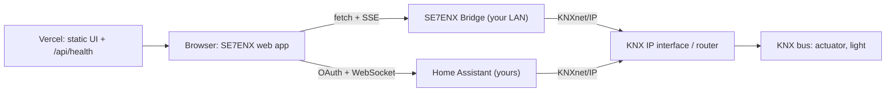

# SE7ENX Smart Building Platform: Technical Specification & User Guide

| | |
| --- | --- |
| **Release described** | SE7ENX Smart Light Experience, commit `f51c06c` |
| **Document date** | 2026-10-15 |
| **Audience** | Owners, installers, operators and developers |
| **Related** | [USER_GUIDE.md](USER_GUIDE.md) (non-technical steps) · [SECURITY_AUDIT.md](SECURITY_AUDIT.md) · [DEPLOYMENT_CHECKLIST.md](DEPLOYMENT_CHECKLIST.md) · [docs/ARCHITECTURE.md](docs/ARCHITECTURE.md) · [docs/API.md](docs/API.md) · [bridge/README.md](bridge/README.md) |

**Status labels used throughout**

| Label | Meaning |
| --- | --- |
| ✅ **Implemented** | In the code and covered by automated tests |
| 🟡 **Implemented, unverified** | In the code, but not verified against real hardware or the real third-party service |
| 🧪 **Simulated** | A stand-in used for demos/tests; never controls hardware |
| 🔷 **Proposed — Not Yet Implemented** | Design proposal only; does not exist in the product |

---

## 1. Overview

SE7ENX lets a person switch a **real KNX light** with **hand gestures**, **voice** or **manual
controls**, or try everything instantly in **simulation**. The UI centres on an interactive 3D lamp
that always shows which mode is active. It also keeps three kinds of state apart:

* **Simulated**: the in-browser lamp, used only in simulation mode.
* **Requested**: what you asked for, and how far that request got (`pending → accepted / bus confirmed / failed`).
* **Reported**: what the installation itself reported through a status/feedback group address or a read response.

**The platform today (facts).** It controls one light per session. It has three modes (Simulation,
Home Assistant, Local KNX Bridge), and the browser talks **directly** to the user's bridge or Home
Assistant. Vercel hosts the UI and a health endpoint only. There are **no user accounts, no database
and no cloud backend**. "Smart Building Platform" names the product direction; multi-room, multi-user
and account features are 🔷 proposed only (§3.2,
[target architecture](docs/ARCHITECTURE.md#target-architecture-proposed--not-implemented)).



**Design principles.** Nothing is reported as confirmed unless the backend proves it. No automatic
ON/OFF happens after connecting. The camera and microphone start only on an explicit click.
Hands-free input can be stopped instantly. KNX equipment is never exposed to the internet.

---

## 2. Requirements

### 2.1 To use the app (everyone)

| Need | Detail |
| --- | --- |
| Browser | Current Chrome or Edge (tested engine: Chromium). Safari and Firefox are expected to work for simulation and manual control but were **not tested** |
| 3D lamp | WebGL; without it a 2D lamp is shown automatically |
| Gestures | A camera, HTTPS (or `localhost`), permission granted after clicking **Enable camera** |
| Voice | A browser with the Web Speech API (Chrome, Edge, Safari; **not** Firefox by default) and a microphone |
| Connection | Internet to load the app; the bridge or Home Assistant must be reachable **from your device** |

### 2.2 To control a real light through the SE7ENX Bridge

| Need | Detail |
| --- | --- |
| KNX interface | A KNXnet/IP **tunnelling interface** (UDP, TCP, or KNX Secure) with a free tunnel slot, or a **KNX IP router** (routing / secure routing) |
| Actuator | A switching channel with a **DPT 1.001** object, or a dimming actuator with a **DPT 5.001** brightness object; a **status/feedback object** on its own group address is strongly recommended |
| Bridge host | Computer, Raspberry Pi or NAS on the **same LAN** as the interface; Python ≥ 3.11, or Docker |
| Reachability | The browser must reach the bridge; HTTPS (Tailscale Serve, mkcert, reverse proxy) is recommended and required for most phones (see §6.6) |
| Knowledge | The light's group addresses (from the ETS project) |

### 2.3 To control a real light through Home Assistant

| Need | Detail |
| --- | --- |
| Home Assistant | With the **KNX integration** configured and working |
| Reachability | HA reachable over **HTTPS** from your device (e.g. Nabu Casa remote UI or your own domain); `http://localhost` works except in Safari |
| HA user | Any HA user can send commands. Live bus confirmation requires an administrator, but see §4.4 for why a dedicated non-admin user is the safer choice |

### 2.4 To develop or self-host

Node.js ≥ 20.9 with npm; Python ≥ 3.11 for the bridge; optionally Docker. For browser tests:
Playwright's Chromium (`npx playwright install chromium`).

---

## 3. Getting Started

### 3.1 First run (no setup)

1. Open the app. The lamp appears immediately in **Simulation** (violet "Simulated" badge, label
   `SIMULATION · OFF`).
2. Tap the lamp, press **Switch ON / Switch OFF** in the **Control** tab, or focus the lamp and use
   the keyboard. Simulation never touches hardware.
3. Optional: try gestures (**Gesture** tab → **Enable camera**) and voice (**Voice** tab →
   **Enable voice commands**) on the simulated lamp.
4. To control a real light, press **Connect KNX** in the header.

### 3.2 Accounts: 🔷 Proposed — Not Yet Implemented

SE7ENX has **no sign-up, sign-in, password reset, profile or account deletion**. There is nothing
to register. Instead:

* settings (gesture, voice, connection details) are saved **in this browser only** (`localStorage`);
* a bridge connection is authorised by **pairing** (a code shown on the bridge), and lasts for that browser tab;
* a Home Assistant connection is authorised by signing in to **your own** Home Assistant.

An optional account system (for syncing non-secret preferences and a list of paired home agents)
is described as a proposal in
[docs/ARCHITECTURE.md](docs/ARCHITECTURE.md#target-architecture-proposed--not-implemented).
It would **never** store Home Assistant tokens or KNX secrets in the cloud.

### 3.3 Choosing a connection path

| | **Local KNX Bridge** | **Home Assistant** |
| --- | --- | --- |
| Best for | KNX installations with an IP interface/router, no HA | Homes already running HA with KNX |
| Install | The SE7ENX Bridge on your LAN | Nothing extra |
| Command scope | Only group addresses **allowlisted on the bridge** | Any group address your HA user can reach (no allowlist; see §4.4) |
| Bus confirmation | Yes (tunnelling, positive `L_Data.con`) | Admin users only |
| Verification status | 🟡 Tested against a protocol-level fake interface | 🟡 Tested against a mock HA server only |

---

## 4. Connecting Home Assistant

> 🟡 **Implemented, unverified.** This flow is implemented and tested against a mock Home
> Assistant WebSocket server. It has **not** been verified against a real Home Assistant instance.
> Treat it as experimental.

### 4.1 Prerequisites

* The KNX integration works in HA (you can switch the light from HA itself).
* HA is reachable over **HTTPS** from the device running SE7ENX.
* You know the light's switching group address and, ideally, its status group address.

### 4.2 The actual sign-in flow (what happens)

1. **Connect KNX** → *Mode*: **Home Assistant** → **Next**.
2. *Backend*: enter **Home Assistant URL** (e.g. `https://myhome.example.com`). The app only accepts
   `https://` URLs, or `http://` on loopback.
3. Press **Sign in with Home Assistant**. The app stores a random `state` value plus your wizard
   draft in `sessionStorage['se7enx.ha.pending']` (valid 10 minutes). It then navigates to
   `<HA URL>/auth/authorize` with `client_id = <app origin>/` and
   `redirect_uri = <app origin>/?se7enx_ha_callback=1`.
4. You log in **on your own Home Assistant login page** (including MFA if you use it). SE7ENX never
   sees your password.
5. HA redirects back with a one-time `code` and the `state`. The app checks that `state` matches and
   is fresh, removes `code` from the address bar, and exchanges the code at `<HA URL>/auth/token`.
   HA allows this cross-origin call.
6. The app receives an **access token** (valid 30 minutes, refreshed automatically) and a
   **refresh token**, stores both in `sessionStorage['se7enx.ha.tokens']` for this tab, and opens
   HA's WebSocket API.
7. *Test link* runs these checks: **Home Assistant reachable & signed in**, **KNX integration loaded**,
   **knx.send available**, **State read-back**, **Live bus events**, **KNX interface link (in HA)**.
   Press **Run again** after fixing a problem.
8. *Address*: **Light group address (switching)** and **Datapoint type**.
9. *Feedback*: **Status / feedback group address (optional, recommended)**, optionally
   **Read current state (GroupValueRead)**, then **Activate live control**.
10. *Test*: read the warning **"This operates real equipment"**, tick **I understand that this
    switches real equipment and it is safe to do so now.**, then **Send test ON** / **Send test OFF**,
    or **Skip test**.
11. *Control*: **Set up gestures**, **Set up voice**, or **Done**.

### 4.3 What you get, by HA account type

| HA account | Commands | Bus confirmation | Device state |
| --- | --- | --- | --- |
| Administrator | `knx.send` | Outgoing `knx_event` observed within 3.5 s → "bus confirmed" | Live `knx_event` on the status address + `knx.read` |
| Regular user | `knx.send` | Not available (reported as *accepted*) | `knx.read` with response (recent HA versions); otherwise none |

### 4.4 Security notes (read before connecting)

* **Token scope.** Home Assistant tokens have **no scopes**: SE7ENX's token can do everything your
  HA user can do, not just this one light. An administrator token can control the whole home and
  change HA's configuration.
* **Token lifetime.** The refresh token stays valid in HA for up to 90 days after its last use.
  SE7ENX keeps it in this tab's `sessionStorage` (cleared when the tab closes), where any script
  running on the SE7ENX site could read it ([SE7-01](SECURITY_AUDIT.md)).
* **No address allowlist.** On this path, SE7ENX can write to **any** group address you type. A typo
  could switch a different device ([SE7-08](SECURITY_AUDIT.md)).
* **Recommendation.** Create a **dedicated, non-administrator HA user** for SE7ENX, and accept that
  bus confirmation is then unavailable. Use a shared or public computer only if you disconnect afterwards.
* **Disconnecting.** **Disconnect** asks HA to revoke the refresh token. If HA is unreachable at that
  moment the token stays valid, so check **HA → your profile → Security → Refresh tokens** and
  delete the SE7ENX entry if present.

---

## 5. Operating the Platform

### 5.1 Screen layout

* **Header**: mode/connection status, **Connect KNX** / **Connection**, and the emergency button
  **Stop hands-free** (becomes **Resume hands-free**). `Esc` also stops hands-free input.
* **Lamp stage**: the 3D lamp with a state label (`SIMULATION`, `CONNECTING`, `CONNECTED`, `ON`,
  `OFF`, `ERROR`, `RECONNECTING`, `UNVERIFIED`) and certainty badges. Tap or use the keyboard to toggle.
* **Panels / tabs**: **Control**, **Gesture**, **Voice**, **History** (labelled **Log** on small screens).

### 5.2 Reading the lamp truthfully

| You see | It means |
| --- | --- |
| `SIMULATION · ON/OFF`, violet badge | In-browser simulation; no hardware involved |
| `ON`/`OFF` + "Device confirmed" | The installation reported this state (status telegram or read response). See the caveat in §9 |
| "requested" ring, then a warning after 4 s | Command accepted/confirmed on the bus, but no device feedback yet |
| `ON · UNVERIFIED`, dimmed glow | No status address, so the real device state cannot be confirmed |
| "Observed on bus" | Another device wrote the switching address (not actuator feedback) |
| `RECONNECTING` | Link lost; last known state shown as stale |
| `ERROR` | Connection or command failure; the panel shows an actionable hint |

### 5.3 Manual control

**Control** tab: **Switch ON**, **Switch OFF**, **Read state**, **Disconnect**,
**Connection settings…**. Manual control always works, including while hands-free input is stopped.

### 5.4 Gestures

1. **Gesture** tab → **Enable camera** (browser permission prompt).
2. Hold an **open hand** above the upper (cyan) line for about 0.5 s → **ON**. Hold it below the
   lower (amber) line → **OFF**. Then move out of the zone to re-arm.
3. **Calibrate** adapts both lines to your position (hold low, then high).
4. **Send gesture commands** off = preview only. **Turn camera off** stops the camera.

| Default | Value |
| --- | --- |
| ON line / OFF line (fraction of frame height, measured from the bottom) | 0.60 / 0.30 |
| Hold time (dwell) | 450 ms |
| Cooldown after a trigger | 1.5 s |
| Minimum tracking confidence | 0.6 (below it, nothing is inferred) |
| Minimum hand size / in-frame ratio | Hand bounding box ≥ 10 % of the frame height / ≥ 85 % of the 21 landmarks inside the frame |

Gestures are a convenience input, **not a safety function**.

### 5.5 Voice

1. **Voice** tab → **Enable voice commands** (asks for the microphone once; nothing is recorded by SE7ENX).
2. Press **Listen** (one phrase, up to 8 s) or start **Hands-free 60 s**. **Stop listening** or
   **Disable** at any time.
3. Choose the **Recognition language**. Optional: **Prefer on-device recognition (experimental)**
   with **Download language pack** (Chrome 139+).

| Language | ON examples | OFF examples |
| --- | --- | --- |
| English | "Light on", "Turn the light on" | "Light off", "Turn the light off" |
| French | "Allume la lumière", "Ouvre la lumière" | "Éteins la lumière", "Ferme la lumière" |
| Arabic (MSA + Algerian Darija) | "شغّل الضوء", "شعّل الضو" | "أطفئ الضوء", "طفّي الضو" |

Only allowlisted phrases are accepted (max 8 words). Negations and ambiguous phrases are rejected.
Voice can only switch the configured light ON or OFF; it can never change settings.

### 5.6 Emergency stop

**Stop hands-free** (or `Esc`) immediately blocks every gesture and voice command and ends
listening. Manual control remains available. This stop applies **to this browser only**: it does
not stop other devices paired with the same bridge ([SE7-07](SECURITY_AUDIT.md)).

### 5.7 History and disconnecting

**History** lists every command with its source (manual, gesture, voice, test) and its truthful
outcome. **Disconnect** ends the bridge session (the bridge revokes the token) or the HA session
(best-effort token revocation).

---

## 6. KNX Integration

### 6.1 Bridge role

The **SE7ENX Bridge** (`bridge/`, FastAPI + xknx 4.0) is the only component that speaks KNXnet/IP.
It runs on your LAN and provides authentication, origin and group-address policy, confirmation
tracking, status feedback and a real-time event stream. Browsers cannot send KNXnet/IP UDP, and
Vercel functions cannot reach a private LAN or hold a tunnel, so this split is required.

### 6.2 Connection types (`SE7ENX_KNX_CONNECTION_TYPE`)

| Value | Meaning | Bus confirmation | Status |
| --- | --- | --- | --- |
| `automatic` (default) | xknx discovers an interface/router | Depends on result | 🟡 |
| `tunneling` | UDP tunnelling to `SE7ENX_KNX_GATEWAY_IP` | ✅ positive `L_Data.con` | ✅ against the fake interface; 🟡 on hardware |
| `tunneling_tcp` | TCP tunnelling (KNXnet/IP v2) | ✅ | 🟡 never tested |
| `tunneling_tcp_secure` | KNX Secure tunnelling (keyring or user credentials) | ✅ | 🟡 never tested |
| `routing` | Multicast routing (`224.0.23.12:3671` by default) | ❌ reported as *accepted* | 🟡 never tested |
| `routing_secure` | Secure routing (backbone key) | ❌ | 🟡 never tested |

### 6.3 Group addresses and datapoints

* **Formats:** three-level `main/middle/sub` (0–31 / 0–7 / 0–255), two-level `main/sub`
  (0–31 / 0–2047), free integer (1–65535). `0/0/0` (broadcast) is refused.
* Validated in the browser **and** again on the bridge using shared test vectors.
* **Syntax is not existence:** a valid address does not prove that a device listens on it. Only a
  confirmed command plus device feedback proves the light works.
* **DPT 1.001** (switch, ON/OFF) and **DPT 5.001** (percentage; ON sends the configured level).

### 6.4 Confirmation and feedback semantics

| Outcome | Meaning |
| --- | --- |
| `bus_confirmed` | The interface returned a **positive** `L_Data.con`: the telegram reached the bus |
| `accepted` | Sent, but the path cannot confirm it (routing, HA non-admin) |
| `KNX_NEGATIVE_CONFIRMATION` / `KNX_CONFIRMATION_TIMEOUT` | Failure: never shown as success |
| Device state | Only from the status address or a read response; otherwise `UNVERIFIED` |

### 6.5 Bridge API (summary)

Base path `/api/v1`; JSON; `Authorization: Bearer <token>` on everything except health and pairing.
Full contract: [docs/API.md](docs/API.md).

| Method & path | Purpose |
| --- | --- |
| `GET /health` | Minimal unauthenticated health |
| `POST /pair` | Exchange the pairing code for a session token |
| `GET /session` · `POST /session/revoke` | Session info · revoke own session |
| `GET /knx/status` · `POST /knx/connect` · `POST /knx/disconnect` · `POST /knx/discover` · `POST /knx/test` | KNX link management and non-writing connectivity test |
| `PUT` / `GET` / `DELETE /lights/{id}` | Register / read / remove a light (switch GA, status GA, DPT) |
| `GET /lights/{id}/state[?refresh=1]` | Current reported state (optionally sends a GroupValueRead) |
| `POST /lights/{id}/on` · `POST /lights/{id}/off` | Commands with idempotent `requestId` |
| `GET /events` | Server-sent events: `hello`, `knx.status`, `light.state` |

### 6.6 Reaching the bridge from the HTTPS app

| Setup | Works in |
| --- | --- |
| `http://127.0.0.1:8787` (bridge on the same computer) | Chrome, Edge, Firefox; not Safari |
| `https://bridge.<tailnet>.ts.net` via Tailscale Serve | All browsers incl. phones (**recommended**) |
| `https://<LAN-IP>:8787` with a trusted certificate (mkcert) | Browsers that trust the certificate |
| `http://<LAN-IP>:8787` | Chrome/Edge 142+ after allowing **Local network access**; **unencrypted** (token visible on the LAN, [SE7-05](SECURITY_AUDIT.md)) |

**Never** forward a router port to the bridge or to the KNX interface.

### 6.7 Commissioning checklist (installer)

Use [DEPLOYMENT_CHECKLIST.md](DEPLOYMENT_CHECKLIST.md) §3. In short: allowlist only the light's
addresses; verify the status object sends on change and has the read flag; run *Test link*; send
the acknowledged test with someone watching the light; test the link-loss behaviour.

---

## 7. Privacy & Security

### 7.1 What leaves your device

| Data | Goes to | When |
| --- | --- | --- |
| Commands, light configuration, session token | **Your** bridge or **your** Home Assistant | While connected |
| **MediaPipe usage telemetry**: SDK version, task type, latency statistics, plus your IP address, browser user agent and the site's origin/referrer | **Google** (`odml.pa.googleapis.com`) | About every 60 s while hand tracking runs, and when it stops |
| Voice audio | Your browser vendor's speech service (Google/Apple) unless on-device recognition is active | Only while listening |
| Page requests | Vercel (hosting) | Page load |

**Camera.** Video frames and hand landmarks are processed on your device and are **never uploaded
or recorded**. The MediaPipe library used for hand tracking does, however, send the **usage
telemetry** listed above to Google. It contains **no images, landmarks or audio**. The audit
confirmed this by network capture ([SE7-03](SECURITY_AUDIT.md)). There is no setting to turn it
off. Blocking it is a proposed fix.

### 7.2 What is stored in your browser

| Key | Storage | Contents |
| --- | --- | --- |
| `se7enx.settings.v1` | `localStorage` (persistent) | Gesture/voice settings, bridge URL, HA URL, group addresses, DPT (no secrets) |
| `se7enx.bridge.session` | `sessionStorage` (this tab) | Bridge URL, session token, expiry |
| `se7enx.ha.tokens` | `sessionStorage` (this tab) | Home Assistant access + refresh tokens |
| `se7enx.ha.pending` | `sessionStorage` (≤ 10 min) | OAuth `state` + wizard draft during sign-in |

No cookies are used. SE7ENX operates no server-side database.

### 7.3 Security controls (summary)

Bridge: Origin allowlist (wildcards refused), pairing code (random, single use, rotating, constant
time), hashed 256-bit session tokens with expiry and revocation, **default-deny group-address
allowlist** for reads and writes, strict input validation, rate limits, idempotent commands,
security headers, no API docs exposed. Web: CSP, `frame-ancestors 'none'`, `X-Frame-Options: DENY`,
`nosniff`, Referrer-Policy, Permissions-Policy, COOP; no secrets in the frontend; OAuth `state`
protection. Details: [docs/SECURITY.md](docs/SECURITY.md).

### 7.4 Known weaknesses

See the [audit findings register](SECURITY_AUDIT.md#4-findings-register). The most important:
full-scope HA tokens in browser storage (SE7-01), possible stale "Device confirmed" after a read
timeout or reconnect (SE7-02), the MediaPipe telemetry (SE7-03), no roles on the bridge (SE7-04),
plain-HTTP default to the bridge (SE7-05), and a client-only emergency stop (SE7-07).

---

## 8. Troubleshooting

| Problem | What to check |
| --- | --- |
| Lamp shows `SIMULATION` | You are in simulation; use **Connect KNX**. Simulation never controls hardware |
| "Cannot reach the SE7ENX Bridge" | Bridge running? URL and port right? `SE7ENX_HOST` not `127.0.0.1` when connecting from another device? App origin listed in `SE7ENX_ALLOWED_ORIGINS`? Mixed-content rules (§6.6)? |
| Chrome asks to allow "local network access" | Expected for `http://<LAN-IP>` bridges in Chrome/Edge 142+; allow it, or use HTTPS (Tailscale Serve) |
| "Pairing code is wrong or has expired" | Random codes are single-use and rotate every 15 min; use the newest code from the bridge log |
| `PAIRING_LOCKED` | 20 failed attempts lock pairing for 5 min for everyone; wait, then use the newest code. Repeated locks may mean someone is guessing |
| `GA_NOT_ALLOWED` | Add the address to `SE7ENX_ALLOWED_GROUP_ADDRESSES` on the bridge and restart it |
| `KNX_CONFIRMATION_TIMEOUT` / `KNX_NEGATIVE_CONFIRMATION` | Interface not connected to the bus, bus power missing, interface overloaded or tunnel slots exhausted |
| ON confirmed, lamp keeps "waiting for feedback" | Wrong status address, or the actuator does not send status on change |
| `ON · UNVERIFIED` | No status address configured, so the device state cannot be confirmed |
| "Device confirmed" right after a reconnect looks wrong | Known issue SE7-02: the bridge may return a cached value when a read times out. Check the light physically; ensure the status object has the read flag |
| Live updates stop behind a reverse proxy | Disable buffering/compression for `/api/v1/events` |
| Camera "permission denied" / "in use" | Allow the camera in site settings; close other apps using it; HTTPS or `localhost` required |
| Hand not detected | More light, whole hand in frame, open palm facing the camera; use **Calibrate** |
| Voice not available | Browser without the Web Speech API (e.g. Firefox); use gestures or manual control |
| Home Assistant sign-in loops or fails | HA must be reachable over HTTPS from this device; restart sign-in from the wizard (stale callbacks are refused on purpose) |
| HA: commands work but no bus confirmation | Expected for non-admin HA users (§4.3) |

---

## 9. Limitations

* One light per wizard session (the bridge API accepts up to 16 lights per session).
* DPT 1.001 and 5.001 only; no dimming slider, scenes, rooms or colour.
* **Not verified on real KNX hardware or a real Home Assistant.** TCP tunnelling, KNX Secure and
  routing are implemented through xknx but untested ([SE7-22](SECURITY_AUDIT.md)).
* "Device confirmed" can be stale after a read timeout or KNX reconnect until SE7-02 is fixed.
* The emergency stop is per browser, not bridge-wide.
* The bridge keeps sessions in memory: a restart requires pairing again. There are no roles and no
  way to revoke someone else's session except by restarting the bridge.
* Gesture recognition depends on light, camera and device performance. It is a convenience input,
  not a safety function.
* Speech recognition availability, accuracy and privacy depend on the browser vendor.
* Routing and non-admin HA sessions cannot provide bus confirmation.
* No accounts, no multi-user management, no remote-access service, no monitoring.

---

## 10. Developer & Deployment Guide

### 10.1 Repository layout

```
src/app/                 Next.js app router (page, layout, /api/health)
src/components/          UI: lamp (R3F + 2D fallback), panels, wizard, primitives
src/lib/                 knx, state, commands, adapters, bridge client, ha, gesture, voice, net
tests/                   unit · integration · e2e (Vitest + Playwright)
bridge/                  SE7ENX Bridge (FastAPI + xknx), tests, tools, Docker, systemd
audit/                   security probes used by SECURITY_AUDIT.md + raw results
docs/                    API contract, architecture, security model, screenshots
```

### 10.2 npm scripts (exact, from `package.json`)

| Script | Runs |
| --- | --- |
| `npm run dev` | `node scripts/prepare-assets.mjs && next dev` |
| `npm run build` | `node scripts/prepare-assets.mjs && next build` |
| `npm start` | `next start` |
| `npm run lint` | `eslint .` |
| `npm run typecheck` | `tsc --noEmit` |
| `npm test` | `vitest run` (unit + integration) |
| `npm run test:unit` / `test:integration` / `test:watch` | Vitest subsets / watch mode |
| `npm run test:e2e` | `playwright test` (starts the app and the bridge dev stack) |
| `npm run check` | lint + typecheck + test + build |
| `npm run assets` | Copies the MediaPipe WASM and verifies the hand model's SHA-256 |
| `postinstall` | `prepare-assets.mjs --wasm-only` |

### 10.3 Web app environment variables (all optional, none secret)

| Variable | Effect |
| --- | --- |
| `NEXT_PUBLIC_DEFAULT_BRIDGE_URL` | Pre-fills **Bridge URL** in the wizard |
| `NEXT_PUBLIC_HAND_MODEL_URL` | Override the hand model URL (default self-hosted `/models/hand_landmarker.task`; overrides are not integrity-checked at runtime, SE7-20) |
| `NEXT_PUBLIC_MEDIAPIPE_WASM_BASE` | Override the WASM base path (default `/mediapipe/wasm`) |
| `SE7ENX_FRAME_ANCESTORS` | CSP `frame-ancestors` (default `'none'`) |
| `SE7ENX_ALLOWED_DEV_ORIGINS` | Extra dev-server origins (development only) |
| `SE7ENX_DEV_BRIDGE_REWRITE` | **Demo/preview only**: same-origin rewrite `/demo-bridge/*` → one bridge URL. **Never set in production** (SE7-10) |

Variables read in `next.config.ts` apply at **build time**; redeploy after changing them.

### 10.4 Bridge configuration (environment variables, defaults)

| Variable | Default | Notes |
| --- | --- | --- |
| `SE7ENX_HOST` / `SE7ENX_PORT` | `127.0.0.1` / `8787` | The Docker image sets `0.0.0.0` (SE7-15) |
| `SE7ENX_BRIDGE_NAME` | `SE7ENX Bridge` | Max 64 chars |
| `SE7ENX_ALLOWED_ORIGINS` | `http://localhost:3000,http://127.0.0.1:3000` | Exact origins; `*` and `null` refused |
| `SE7ENX_PAIRING_CODE` | unset → random, single use, rotating | Fixed codes: 8–32 `A–Z0–9`; choose a long random value (SE7-13) |
| `SE7ENX_PAIRING_TTL_MIN` | `15` | 1–1440 |
| `SE7ENX_SESSION_TTL_HOURS` | `12` | 1–168 |
| `SE7ENX_MAX_SESSIONS` | `10` | Oldest session is evicted at the cap (SE7-11) |
| `SE7ENX_ALLOWED_GROUP_ADDRESSES` | empty = **deny all** | Switching + status addresses of your light(s) |
| `SE7ENX_KNX_CONNECTION_TYPE` | `automatic` | See §6.2 |
| `SE7ENX_KNX_GATEWAY_IP` / `SE7ENX_KNX_GATEWAY_PORT` | — / `3671` | Required for tunnelling types |
| `SE7ENX_KNX_LOCAL_IP`, `SE7ENX_KNX_ROUTE_BACK`, `SE7ENX_KNX_INDIVIDUAL_ADDRESS` | — / `false` / — | Network specifics |
| `SE7ENX_KNX_MULTICAST_GROUP` / `SE7ENX_KNX_MULTICAST_PORT` | `224.0.23.12` / `3671` | Routing |
| `SE7ENX_KNX_AUTOCONNECT` | `true` | Connect at start-up |
| `SE7ENX_KNX_KEYRING_PATH`, `SE7ENX_KNX_KEYRING_PASSWORD` | — | KNX Secure keyring |
| `SE7ENX_KNX_SECURE_USER_ID`, `SE7ENX_KNX_SECURE_USER_PASSWORD`, `SE7ENX_KNX_SECURE_DEVICE_AUTH_PASSWORD` | — | KNX Secure tunnelling credentials |
| `SE7ENX_KNX_BACKBONE_KEY` | — | Secure routing |
| `SE7ENX_ALLOW_CLIENT_GATEWAY_CONFIG` | `false` | Lets paired clients choose the gateway |
| `SE7ENX_CLIENT_GATEWAY_CIDRS` | private ranges incl. `169.254.0.0/16` | Restricts the override (SE7-14) |
| `SE7ENX_ENABLE_DISCOVERY` | `true` | Interface discovery for paired clients |
| `SE7ENX_ENABLE_DOCS` | `false` | OpenAPI docs |
| `SE7ENX_TLS_CERT` / `SE7ENX_TLS_KEY` | — | Serve HTTPS directly |
| `SE7ENX_TRUST_PROXY` | `false` | Only behind a reverse proxy, with the bridge bound to `127.0.0.1`. It currently trusts `X-Forwarded-For` from any peer and uses its left-most entry, which clients can pre-set (SE7-06) |
| `SE7ENX_COMMAND_LIMIT` / `SE7ENX_COMMAND_WINDOW_S` | `6` / `10` | Per-session command rate |
| `SE7ENX_GLOBAL_COMMAND_LIMIT` | `20` | Per bridge per 10 s |
| `SE7ENX_LOG_LEVEL` | `INFO` | |

### 10.5 Bridge commands

| Command | Purpose |
| --- | --- |
| `se7enx-bridge` (or `se7enx-bridge serve`) | Run the bridge |
| `se7enx-bridge scan` | Discover KNXnet/IP interfaces/routers on the LAN (multicast) |
| `se7enx-bridge check-config` | Print the effective configuration as JSON (secrets masked) |
| `python tools/dev_stack.py [--host] [--port 8799] [--origin …] [--pairing-code …]` | Bridge + fake interface for demos/tests 🧪 |
| `python tools/fake_knx_interface.py [--switch 0/0/1] [--status 0/0/2] [--confirm positive\|negative\|none] [--no-feedback] [--readable-switch]` | Protocol-level fake KNXnet/IP interface 🧪 |

### 10.6 Deploying

* **Web app → Vercel:** import the repository (preset *Next.js*, default build `npm run build`).
  Set no secrets. Add the deployment origin to the bridge's `SE7ENX_ALLOWED_ORIGINS`. Verify
  `https://<app>/api/health` returns `"knx": {"handledHere": false}`.
* **Bridge:** venv + `pip install .`, the systemd unit `bridge/deploy/se7enx-bridge.service`, or
  `docker compose` in `bridge/`. See [bridge/README.md](bridge/README.md) and
  [DEPLOYMENT_CHECKLIST.md](DEPLOYMENT_CHECKLIST.md).

### 10.7 Testing and audit tooling

```bash
npm run lint && npm run typecheck && npm test && npm run build
npx playwright install chromium && npm run test:e2e
cd bridge && .venv/bin/python -m pytest && .venv/bin/ruff check . && .venv/bin/ruff format --check .
bridge/.venv/bin/python audit/bridge_probes.py            # security probes (see audit/README.md)
```

---

## 11. Feature & Compatibility Matrix

### 11.1 Features

| Feature | Status |
| --- | --- |
| Simulation mode, 3D lamp, 2D fallback | ✅ |
| Requested vs reported state, truthful labels | ✅ (stale-state caveat SE7-02) |
| Gesture control with calibration | ✅ (fake camera in tests; real-hand use 🟡) |
| Voice control EN/FR/AR | ✅ with scripted recognizer; real speech services 🟡 |
| Emergency stop for hands-free input | ✅ per browser; bridge-wide 🔷 |
| Connection wizard with acknowledged test command | ✅ |
| SE7ENX Bridge, UDP tunnelling | ✅ vs fake interface · 🟡 hardware |
| SE7ENX Bridge, TCP / KNX Secure / routing | 🟡 |
| Home Assistant path | 🟡 (mock only) |
| Fake KNX interface, demo stack | 🧪 |
| Multiple lights / rooms / scenes | 🔷 |
| User accounts | 🔷 Proposed — Not Yet Implemented |
| Bridge roles, admin session management | 🔷 |
| Remote access without VPN (relay) | 🔷 |

### 11.2 Browsers

| | Chrome / Edge (desktop) | Chrome (Android) | Safari (macOS / iOS) | Firefox |
| --- | --- | --- | --- | --- |
| Simulation, manual control | ✅ tested (Chromium) | ✅ tested (mobile emulation) | Expected, not tested | Expected, not tested |
| Gestures | ✅ tested (fake camera) | Expected | Expected, not tested | Expected, not tested |
| Voice | ✅ tested (stub) | Expected | Expected (Apple speech service) | ❌ not available by default |
| Bridge over `http://127.0.0.1` | ✅ | n/a | ❌ blocked | Expected |
| Bridge over `http://<LAN-IP>` | Chrome 142+ with permission | Chrome 142+ with permission | ❌ | ❌ |
| Bridge over HTTPS | ✅ | ✅ | ✅ | ✅ |

### 11.3 Backends

| Backend | Commands | Bus confirmation | Device feedback | Verified on |
| --- | --- | --- | --- | --- |
| Simulation | In-browser | n/a | n/a | ✅ tests |
| Bridge, tunnelling (UDP) | GroupValueWrite | ✅ | Status GA / read | Fake interface |
| Bridge, routing | GroupValueWrite | ❌ (accepted) | Status GA | Not tested |
| HA, admin user | `knx.send` | ✅ (outgoing event) | `knx_event`, `knx.read` | Mock HA |
| HA, regular user | `knx.send` | ❌ (accepted) | `knx.read` (recent HA) | Mock HA |

---

## 12. User Quick-Start Checklist

**Try it (2 minutes)**
- [ ] Open the app and see the lamp in `SIMULATION`.
- [ ] Toggle it by tapping, with **Switch ON/OFF**, or with the keyboard.
- [ ] Optional: **Gesture** → **Enable camera**, raise and lower an open hand.
- [ ] Optional: **Voice** → **Enable voice commands** → **Listen** → "Light on".

**Connect a real light (bridge)**
- [ ] Bridge installed on the LAN, `SE7ENX_ALLOWED_ORIGINS` = the app origin, allowlist = the light's addresses only.
- [ ] Bridge reachable over HTTPS (Tailscale Serve or mkcert) or `http://127.0.0.1` on the same computer.
- [ ] **Connect KNX** → **Local KNX Bridge** → **Bridge URL** → **Check bridge** → **Pairing code** → **Pair**.
- [ ] *Test link*: all checks green (**Run again** after fixes).
- [ ] Enter **Light group address (switching)**, **Datapoint type**, **Status / feedback group address**.
- [ ] **Read current state (GroupValueRead)** → **Activate live control**.
- [ ] Someone watches the light → tick the acknowledgement → **Send test ON** / **Send test OFF**.
- [ ] Lamp shows "Device confirmed" matching the real light.

**Connect a real light (Home Assistant, experimental)**
- [ ] Dedicated non-admin HA user created; HA reachable over HTTPS.
- [ ] **Connect KNX** → **Home Assistant** → **Home Assistant URL** → **Sign in with Home Assistant**.
- [ ] Double-check the group address before the test command (no allowlist on this path).

**Every session**
- [ ] Know where **Stop hands-free** is (`Esc` works too).
- [ ] **Disconnect** when finished, especially on shared devices.
