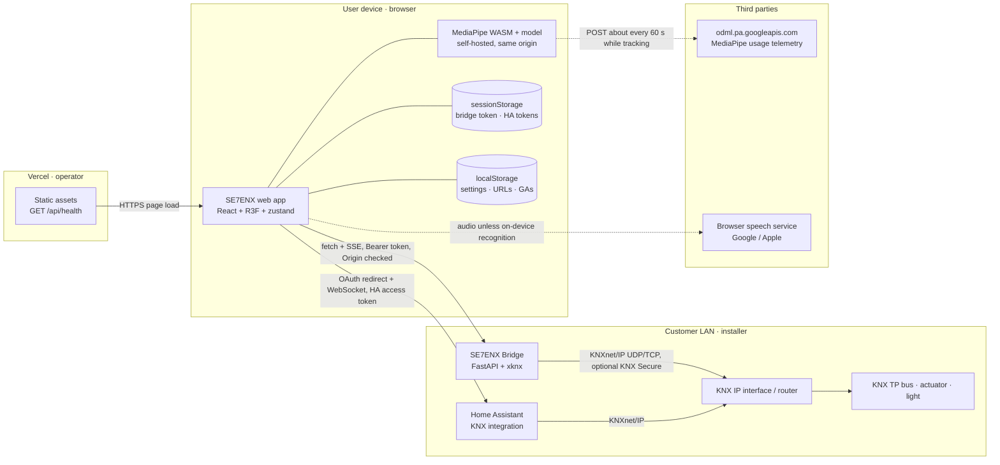
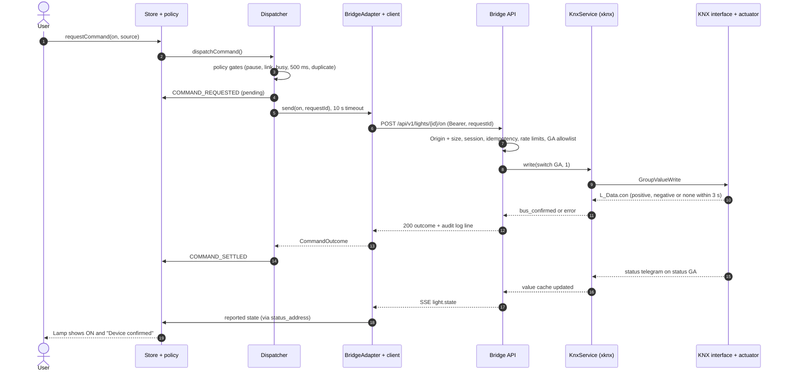
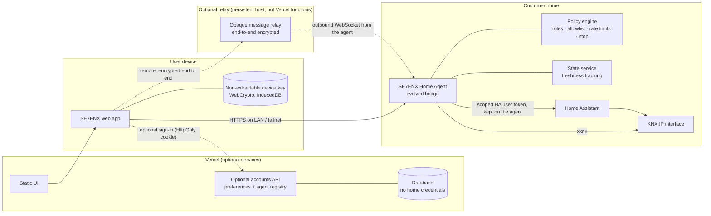
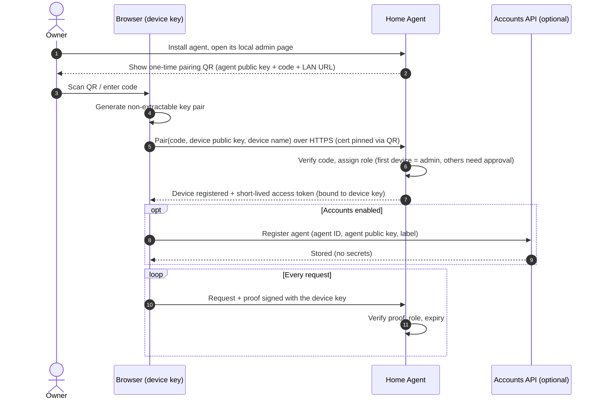
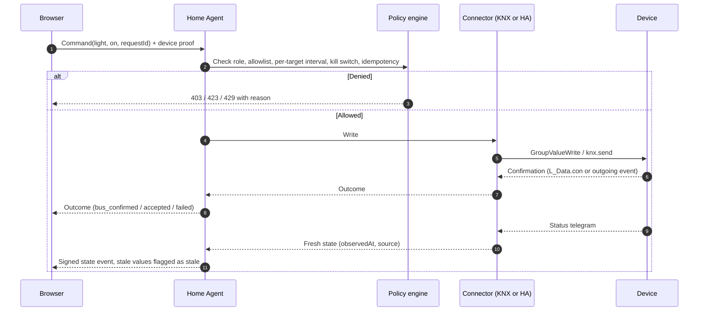
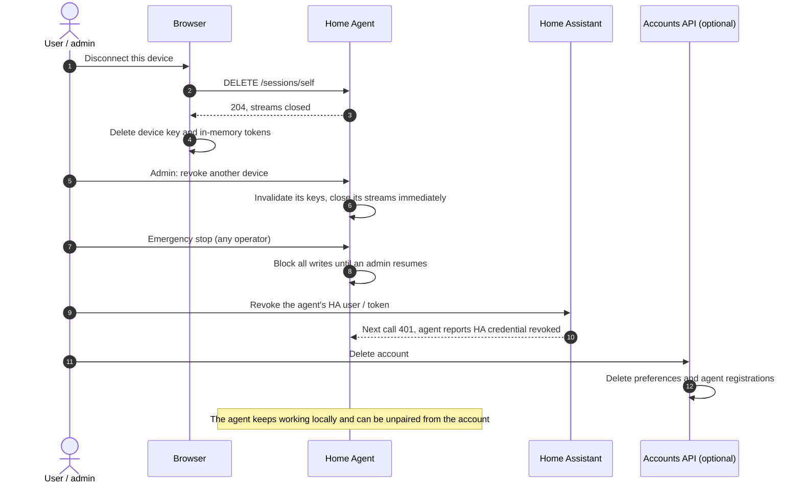

# Architecture

> **Status of this document.** The design sections below describe the code at commit
> `f51c06c` and were re-verified during the
> [2026-10-15 technical & security audit](../SECURITY_AUDIT.md). The sections from
> [Verified current architecture](#verified-current-architecture-audit-2026-10-15) onwards were added
> by that audit: Mermaid diagrams with trust boundaries, a traced command lifecycle, where data
> lives, the dependency map, the implementation-status matrix, and a **proposed** target
> architecture for real users (not implemented).

## Why this shape

A browser cannot speak KNXnet/IP (raw UDP) and a Vercel function cannot reach a
customer's private LAN, broadcast/multicast UDP, or hold a persistent tunnel.
So the system is split:

| Part | Runs on | Responsibility |
| --- | --- | --- |
| **Web app** (Next.js 16, React 19, TypeScript) | Vercel / any static host | UI, 3D lamp, simulation, gesture recognition (MediaPipe WASM; inference runs on the device, but the SDK also sends usage telemetry to Google; see [SE7-03](../SECURITY_AUDIT.md)), voice (Web Speech API), state machine, wizard. Only server route: `GET /api/health`. |
| **SE7ENX Bridge** (Python 3.11+, FastAPI, xknx 4) | PC / Raspberry Pi / NAS on the customer LAN | Pairing & sessions, origin + group-address policy, KNXnet/IP tunnelling (UDP/TCP, KNX Secure) or routing via xknx, confirmation tracking, status feedback, SSE events. |
| **Home Assistant** (alternative) | Customer's HA | Existing KNX integration; SE7ENX uses HA's OAuth + WebSocket API (`knx.send`, `knx.read`, `knx_event`). |

The browser connects **directly** to the bridge or HA. Nothing KNX-related passes through Vercel.

```
┌──────────────────────── Browser ─────────────────────────┐
│  LampStage (R3F)  StateStrip  Panels  ConnectionWizard   │
│        ▲               ▲                    │            │
│        └──── zustand store (lightReducer) ◄─┘            │
│                    ▲         │ dispatchCommand()         │
│   GestureEngine ───┤         ▼  policy: pause/link/busy/ │
│   VoiceAllowlist ──┘    LightAdapter   rate/duplicate    │
│                   ┌─────────┼──────────────┐             │
│          Simulation   BridgeAdapter   HomeAssistantAdapter
└───────────────────────────────┼──────────────┼───────────┘
                     fetch + SSE│              │ WebSocket (OAuth)
                    ┌───────────▼───┐    ┌─────▼──────────┐
                    │ SE7ENX Bridge │    │ Home Assistant │
                    │  xknx 4       │    │  KNX integration│
                    └───────┬───────┘    └─────┬──────────┘
                KNXnet/IP UDP/TCP (+Secure)    │
                    ┌───────▼──────────────────▼─┐
                    │ KNX IP interface / router  │── KNX TP bus ── actuator ── light
                    └────────────────────────────┘
```

## State model — never mix the three kinds of state

`src/lib/state/light-machine.ts` (pure reducer) tracks:

* **simulated** — the in-browser lamp; only changed by a `simulated` command outcome in simulation mode.
* **requested** — `lastCommand`: value, source, and phase
  `pending → simulated | accepted | bus_confirmed | failed`.
* **reported** — what the installation reported: `value` + `via`
  (`status_address`, `read_response`, `switch_address`), ignored in simulation.

`src/lib/state/selectors.ts#selectLampView` turns this into what the lamp shows:

| Situation | Lamp |
| --- | --- |
| Simulation | `SIMULATION · ON/OFF`, violet "Simulated" badge |
| Connecting / reconnecting / error | `CONNECTING` / `RECONNECTING` (last known, stale) / `ERROR` |
| Status feedback received | `ON`/`OFF`, "Device confirmed". **Caveat (audit SE7-02):** after a read timeout or a KNX reconnect the bridge can return a *cached* value as current, so this label can be wrong until fixed |
| Command confirmed but feedback expected | last reported state + "requested" ring; warning after 4 s without feedback |
| No feedback possible (no status address) | `ON · UNVERIFIED`, dimmed glow |
| Another device wrote the switching address | "Observed on bus" (not actuator feedback) |

## Command path

Every source (manual, lamp tap, keyboard, gesture, voice, wizard test) goes through
`dispatchCommand()` (`src/lib/commands/dispatcher.ts`):

1. **Policy** (`policy.ts`): emergency stop blocks gesture/voice; real modes need a
   connected link and a target; one command in flight; ≥ 500 ms between commands;
   gestures that would not change the state are dropped silently.
2. **Adapter** `send()` with a 10 s timeout.
3. Outcome → `COMMAND_SETTLED` with the truthful phase, or `failed` with code + hint.

## Confirmation semantics

| Backend | `bus_confirmed` means | Device state from |
| --- | --- | --- |
| Bridge, tunnelling | Interface returned a **positive** `L_Data.con` (xknx waits ≤ 3 s; the bridge's `ConfirmingCEMIHandler` additionally checks the confirm bit) | Status address telegrams, GroupValueRead responses |
| Bridge, routing | never — reported as `accepted` (multicast has no confirmation) | same |
| Home Assistant (admin) | outgoing `knx_event` observed (HA fires it only after its interface confirmed) | `knx_event` on the status address, `knx.read` responses |
| Home Assistant (non-admin) | never — reported as `accepted` | `knx.read` with `return_response` (recent HA) |

## Gesture pipeline

`getUserMedia` (explicit click) → MediaPipe Hand Landmarker (WASM, GPU→CPU fallback,
self-hosted model) → `computeHandFeatures` (open palm = ≥4 extended fingers, palm
height) → `GestureEngine`:

* confidence gate (score, hand size, in-frame ratio) — otherwise `low-confidence`, no inference;
* EMA smoothing; separate ON/OFF thresholds with a neutral band;
* dwell (default 450 ms) → trigger; cooldown (1.5 s); re-arm only after leaving the zone or losing the hand;
* frame gaps (> 300 ms) reset dwell; calibration sets thresholds at 30 %/70 % of the user's range.

Triggers go to the dispatcher (never per frame). The preview canvas draws thresholds,
landmarks and dwell progress at frame rate; React state updates at ~10 Hz.

## Voice pipeline

Explicit opt-in (`getUserMedia` permission check, nothing recorded) → push-to-talk
(single utterance, 8 s cap) or 60 s hands-free session → up to 3 alternatives →
normalization (case, accents, Arabic diacritics/letter variants, filler words) →
**exact allowlist** match (EN/FR/AR incl. Algerian Darija) → ambiguity / confidence
checks → dispatcher. Voice can only produce `on`/`off` for the configured light.

## Real-time updates & resilience

* Bridge events via `fetch` streaming (SSE format) so the `Authorization` header and
  Chrome's Local Network Access exemptions apply; reconnect with back-off; 10 s
  first-byte and 45 s idle watchdogs; 401 ends the stream with "pair again".
* Home Assistant reconnects via `home-assistant-js-websocket`; the adapter maps
  `ready` / `disconnected` / `reconnect-error` to link states and re-reads state.

## Key files

| Path | Purpose |
| --- | --- |
| `src/lib/knx/group-address.ts`, `dpt.ts` | GA parsing (3-level/2-level/free), DPT encode/decode |
| `src/lib/state/*` | reducer, selectors, zustand stores, persisted non-secret settings |
| `src/lib/commands/*` | policy + dispatcher |
| `src/lib/adapters/*` | simulation, bridge, Home Assistant adapters |
| `src/lib/bridge/*` | zod contract, typed client, SSE parser |
| `src/lib/ha/oauth.ts` | HA OAuth with state nonce |
| `src/lib/gesture/*` | features, engine, calibration, tracker, overlay drawing |
| `src/lib/voice/*` | allowlist parser, recognizer wrapper, controller |
| `src/lib/net/*` | URL / address-space validation, fetch with timeouts + LNA hint |
| `src/components/*` | UI (lamp, panels, wizard, primitives) |
| `bridge/se7enx_bridge/*` | config, security, group addresses, KNX service, API, CLI |
| `bridge/tools/fake_knx_interface.py` | protocol-level fake KNXnet/IP interface (tests/demos only) |

---

## Verified current architecture (audit 2026-10-15)

Facts verified in code and at runtime. External endpoints include the one the app does **not**
choose to contact (MediaPipe telemetry, [SE7-03](../SECURITY_AUDIT.md)).



**Trust boundaries.** (1) Browser ↔ Vercel: public HTTPS; Vercel stores nothing for the app.
(2) Browser ↔ bridge: crosses the LAN boundary; protected by Origin allowlist + Bearer session +
GA allowlist; **plain HTTP by default** ([SE7-05](../SECURITY_AUDIT.md)). (3) Browser ↔ HA: HA
OAuth; tokens carry the HA user's full rights ([SE7-01](../SECURITY_AUDIT.md)). (4) Bridge/HA ↔
KNX interface: LAN only, never internet-exposed. (5) Browser → Google: unsolicited SDK telemetry.

### Command lifecycle (traced, bridge path)



| # | Step | Code (commit `f51c06c`) |
| --- | --- | --- |
| 1 | Manual button, lamp tap, keyboard, gesture trigger or voice match calls `requestCommand` | `src/lib/state/store.ts:44–52` |
| 2 | Policy: emergency stop blocks gesture/voice; real modes need a connected link; one command in flight; ≥ 500 ms spacing; redundant gestures dropped | `src/lib/commands/policy.ts:14, 32–46` |
| 3 | `COMMAND_REQUESTED` recorded (requested state, phase `pending`) | `src/lib/commands/dispatcher.ts:69` |
| 4 | Adapter `send` raced against a 10 s timeout | `dispatcher.ts:10, 78` |
| 5 | `POST /api/v1/lights/{id}/{on,off}` with `Authorization: Bearer`, `credentials: "omit"`, `requestId` | `src/lib/bridge/client.ts:121, 132, 223–224` |
| 6 | Bridge middleware: Origin allowlist, Private Network Access preflight, body limits | `bridge/se7enx_bridge/api.py:135–221` (Origin `:176`, PNA `:193`) |
| 7 | Session check (Bearer → SHA-256 lookup) | `api.py:374–400`, `security.py:141` |
| 8 | Idempotency cache → per-session limit → global limit → GA allowlist | `api.py:633–636` |
| 9 | `GroupValueWrite` under a send lock; xknx waits for `L_Data.con` | `knx.py:470–472, 434` |
| 10 | Confirmation: positive → `bus_confirmed`; negative → `KNX_NEGATIVE_CONFIRMATION`; none → `KNX_CONFIRMATION_TIMEOUT`; routing → `sent_unconfirmed` | `knx.py:119–133, 439–468` |
| 11 | Audit log line, response | `api.py:679–688` |
| 12 | `COMMAND_SETTLED` with the truthful phase | `dispatcher.ts:79` |
| 13 | Feedback: incoming telegram cached and fanned out | `knx.py:394–416` |
| 14 | SSE `light.state` → adapter → reported state | `api.py:703–750`, `src/lib/adapters/bridge-adapter.ts:74–84` |
| 15 | Lamp derives certainty (`confirmed`, `observed`, `assumed`, `simulated`) | `src/lib/state/selectors.ts:54, 120, 142` |

**Home Assistant path differences.** Step 5 becomes a WebSocket `call_service knx.send`
(`src/lib/adapters/ha-adapter.ts:236`) to whatever GA the wizard holds, with no server-side
allowlist ([SE7-08](../SECURITY_AUDIT.md)). "Bus confirmed" requires an HA **admin** session that
observes an outgoing `knx_event` for the GA within 3.5 s (`ha-adapter.ts:194, 231`); otherwise the
result is `accepted`. Device state comes from `knx_event` on the status GA (admin) or `knx.read`
responses (recent HA).

### Where data lives

| Data | Location | Lifetime | Protection | Removed by |
| --- | --- | --- | --- | --- |
| Bridge session token (43 chars) + bridge URL + expiry | Browser `sessionStorage['se7enx.bridge.session']` | Tab session; token valid 12 h | Same-origin policy only (readable by any script in the origin) | **Disconnect** (also revoked server-side, verified 200 → 401) or closing the tab |
| Bridge session record | Bridge memory, token stored as SHA-256 | ≤ 12 h; lost on bridge restart | Hash only | Revoke, expiry, restart, eviction at cap |
| HA access + refresh tokens, HA URL | Browser `sessionStorage['se7enx.ha.tokens']` (`src/lib/ha/oauth.ts:81`) | Tab session in the browser; the refresh token stays valid in HA for up to 90 days after its last use | Same-origin policy only | Disconnect → best-effort revoke at HA (`oauth.ts:134`) |
| HA OAuth pending login (state nonce, wizard draft) | `sessionStorage['se7enx.ha.pending']` | ≤ 10 min | Nonce | OAuth callback |
| Settings: gestures, voice, connection (bridge URL, HA URL, GA, status GA, DPT, on-level) | Browser `localStorage['se7enx.settings.v1']` | Indefinite | None (no secrets) | Clearing site data |
| Light state, command history, voice transcripts | Memory (zustand) | Page lifetime | — | Reload |
| Camera frames and landmarks | Memory / GPU / WASM only | Per frame | Never stored or uploaded | — |
| Microphone audio | Browser speech engine; Google/Apple servers unless on-device recognition is active | Vendor-defined | Vendor | — |
| MediaPipe usage telemetry (SDK version, task type, latencies; IP, user agent, origin) | Google `odml.pa.googleapis.com` | Vendor-defined | HTTPS | Not controllable today ([SE7-03](../SECURITY_AUDIT.md)) |
| KNX Secure keyring / passwords | Bridge environment / keyring file | Operator-managed | File permissions; masked in `check-config` | Operator |
| Pairing code | Bridge memory; printed to stdout (journald / docker logs) | 15 min (random) or until changed (fixed) | Whoever can read the logs can pair | Rotation |
| Audit log | Bridge stdout → journald / docker logs | Host log retention | Host | Host |
| Cookies | None | — | — | — |
| Vercel | No application data (Vercel keeps its own request logs) | — | — | — |

### Dependency map

| Dependency | Where | Needed for | If unavailable |
| --- | --- | --- | --- |
| WebGL | Local (device) | 3D lamp | 2D fallback lamp |
| `getUserMedia` camera, MediaPipe WASM + model | Local; assets same-origin | Gestures | Gesture panel explains the error; manual control remains |
| `odml.pa.googleapis.com` | External (Google) | Nothing (unsolicited) | Detection keeps working when blocked |
| Web Speech API + vendor speech service | Local API, usually remote processing | Voice | "Not supported" message; manual fallback |
| Vercel (or any static host) | Remote | Serving the UI | App unavailable; bridge/HA unaffected |
| SE7ENX Bridge | Local (LAN) | Real KNX via bridge | Connection error / reconnecting states |
| KNX IP interface / router | Local (LAN) | Real KNX | KNX link error states |
| Home Assistant + KNX integration | Local or remote (user's) | Real KNX via HA | HA error states |
| HTTPS reachability (Tailscale, reverse proxy, Nabu Casa) | External, optional | Reaching bridge/HA from an HTTPS page | Mixed-content / LNA errors with hints |
| `raw.githack.com` | Referenced in the bundle by drei presets | Not used | Never contacted (egress capture) |

### Implementation status

| Capability | Status | Notes |
| --- | --- | --- |
| Simulation mode, 3D lamp, requested-vs-confirmed state model | **Implemented** | Unit + e2e tests |
| Gesture control (MediaPipe, dwell/cooldown/re-arm/confidence gate, calibration) | **Implemented** | e2e with Chromium's fake camera; not tested with a real hand on camera |
| Voice control (allowlist EN/FR/AR, push-to-talk, 60 s hands-free) | **Implemented** | e2e with a scripted recognizer; real speech services not tested; availability depends on the browser |
| Emergency stop for hands-free sources | **Partial** | Client-side only ([SE7-07](../SECURITY_AUDIT.md)) |
| SE7ENX Bridge: pairing, sessions, GA allowlist, tunnelling, confirmation, status feedback, SSE | **Implemented** | Tested against the protocol-level fake interface only |
| KNX TCP tunnelling, KNX Secure, routing | **Partial** | Implemented via xknx configuration; **never tested** (no hardware) |
| DPTs | **Partial** | 1.001 (switch) and 5.001 (percent, for ON level) only |
| Home Assistant path (OAuth, `knx.send`, `knx.read`, `knx_event`) | **Partial** | Mock-tested only; live bus confirmation requires an admin account |
| Fake KNXnet/IP interface, mock HA server, demo dev stack | **Simulated** | Tests and demos only, clearly labelled |
| Multiple lights, rooms, scenes, colour | **Not implemented** | One light per session/UI |
| User accounts, database, server-side storage | **Not implemented** | By design today |
| Bridge roles, administrative session management, bridge-side stop | **Not implemented** | [SE7-04](../SECURITY_AUDIT.md), [SE7-07](../SECURITY_AUDIT.md) |
| Remote-access relay / cloud backend | **Not implemented** | — |
| Monitoring, alerting, bridge update channel | **Not implemented** | — |

---

## Target architecture (proposed — not implemented)

> Everything in this section is a **proposal** produced by the audit. None of it exists in the
> code base. It describes the smallest architecture that would let real users connect their own
> Home Assistant or KNX installation safely.

### Options compared

| Criterion | A. Cloud-mediated (SE7ENX backend holds HA credentials) | B. Local-first agent (recommended) |
| --- | --- | --- |
| Where home-control credentials live | Central database (encrypted), for every customer | Inside each home, on the agent |
| Breach blast radius | **All customers' homes** | One home |
| HA exposure | HA must be reachable from the internet (Nabu Casa or own domain) | HA stays on the LAN |
| KNX bridge path | Bridge must keep an outbound tunnel to a persistent cloud service (not Vercel functions) | Bridge = agent; LAN or VPN access |
| Works without internet | No | Yes, on the LAN |
| Accounts | Required | Optional (sync of non-secret preferences and agent registry only) |
| Compliance burden | High (controller of home-control data and credentials) | Low to moderate |
| Operational cost | Persistent servers, KMS, monitoring, 24/7 incident response | Static hosting (+ optional relay) |
| User effort | Lowest (sign in, done) | Install the agent (Docker or HA add-on) |
| Remote access | Built in | Via the user's VPN (Tailscale), or an optional end-to-end-encrypted relay |

**Recommendation: B (local-first agent).** It keeps the most valuable secrets inside the home. It
matches the KNX rule "never expose the bus to the internet", and it reuses most of the existing
bridge.

### Target components



| Component | Responsibility |
| --- | --- |
| **SE7ENX Home Agent** (evolution of `bridge/`) | Runs in the home (Docker or HA add-on). Holds the KNX connection and/or the HA credential (HA add-on Supervisor token, or a long-lived token for a **dedicated non-admin HA user**). Enforces roles, GA/entity allowlist, per-target rate limits, kill switch and stale-state rules; structured audit log; admin session management. |
| **Web app** | UI only. Keeps no long-lived bearer secret in readable storage: device-bound key pair (non-extractable `CryptoKey`) + short-lived access tokens held in memory. |
| **Accounts API** (optional) | Only if cross-device sync is wanted: passkey/OAuth sign-in, HttpOnly + Secure + SameSite cookies, stores preferences and *registrations* of agents (agent ID, public key, label). **Never** HA tokens or KNX secrets. |
| **Relay** (optional) | For remote access without a VPN: forwards end-to-end-encrypted messages between device keys and the agent's key. It cannot read or forge commands. Requires a persistent host (WebSockets), not Vercel functions. |

### Authentication and pairing flow (proposed)



### Command flow (proposed)



### Disconnect and revocation flows (proposed)



### Minimum changes from today's code (proposed order)

1. **Bridge → agent hardening:** stale-state semantics (SE7-02), roles + admin session API +
   throttled disconnect (SE7-04), bridge-side emergency stop + per-GA interval (SE7-07),
   no silent eviction (SE7-11), log sanitisation (SE7-12).
2. **Move Home Assistant behind the agent:** an HA connector inside the bridge with an
   entity/GA allowlist; remove HA tokens from the browser entirely (SE7-01, SE7-08).
3. **Token handling:** memory-only tokens with short TTL and refresh, then device-bound proofs.
4. **TLS by default:** agent-generated certificate pinned through the pairing QR, or Tailscale
   Serve (SE7-05).
5. **Web hardening:** nonce-based CSP, HSTS, MediaPipe telemetry blocked and disclosed
   (SE7-03, SE7-09).
6. **Only then, optional accounts** (agent registry + preferences, no credentials), and an
   optional end-to-end-encrypted relay for remote access.
